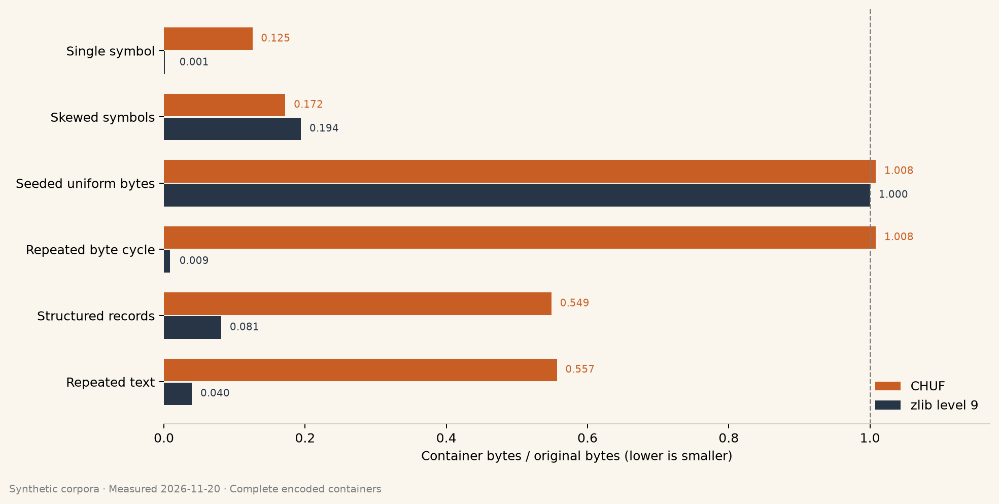

# Canonical Huffman lab

A byte compression codec implemented from source, with a documented binary container, strict decoder validation, and a measured comparison against Python's native zlib wrapper. The core codec uses only the Python standard library; its Huffman coding is implemented here rather than delegated to a compression library.

[Open the report](docs/report.html) · [Binary format](docs/format.md) · [Methodology](docs/methodology.md) · [Findings](docs/findings.md) · [Raw measurements](results/published/measurements.csv)

[Report screenshots](docs/screenshots/README.md) · [Recorded browser walkthrough](docs/recordings/README.md)



## Engineering work

- Deterministic Huffman tree construction and canonical code assignment over all 256 byte values.
- A versioned container with original size, code lengths, exact payload bit count and CRC-32.
- Decoder checks for malformed prefix tables, truncation, trailing bytes, nonzero padding, output mismatch, unused symbols and corruption. Explicit size limits apply before output construction.
- A CLI with bounded file reads and exclusive output creation.
- Independent wire fixtures, randomized roundtrip checks, exhaustive optimality checks on small alphabets, and a valid 255-bit maximum-depth decoder fixture.
- Eight committed synthetic corpora, their encoded outputs, SHA-256 manifests, 224 raw timing observations and reconciled summaries.

## Run

Python 3.11 or newer is required; CI uses Python 3.13.

```sh
python -m pip install -e .
python -m unittest discover -s tests -v
python -m huffman_lab compress results/published/corpora/small.txt sample.chuf
python -m huffman_lab decompress sample.chuf restored.txt
python -m huffman_lab inspect sample.chuf
```

The equivalent installed command is `chuf`. It refuses to overwrite an existing output file. Default limits are 16 MiB of original/decoded data and 32 MiB of encoded input. Decompression can set a different output cap with `--max-output BYTES`; increasing it changes the resource budget.

`inspect` fully validates the payload and CRC, then prints JSON describing the original/container sizes, header overhead, exact bit count, padding and checksum. It does not create a decoded file. Invalid payloads fail with exit code 2; the same decoded-size limit applies.

## Reproduce the evidence

```sh
python scripts/run_study.py --out outputs/my-run
```

The command creates fresh corpora, CHUF and zlib outputs, input/output hashes, environment metadata, raw timings and size/timing summaries. It refuses to overwrite a directory containing a previous measurement file. The committed run in `results/published/` remains unchanged.

To reconcile a new run, set `HUFFMAN_RESULTS` to its directory before running `tests/test_evidence.py`. Examples:

```sh
# POSIX shell
HUFFMAN_RESULTS=outputs/my-run python -m unittest discover -s tests -p test_evidence.py -v
```

```powershell
# PowerShell
$env:HUFFMAN_RESULTS = 'outputs/my-run'
python -m unittest discover -s tests -p test_evidence.py -v
Remove-Item Env:HUFFMAN_RESULTS
```

Rendering the preserved run requires the pinned plotting dependencies:

```sh
python -m pip install -r requirements.txt
python scripts/build_report.py
```

Open `docs/report.html` in a browser, or serve the repository with `python -m http.server 8080`. Report generation reads the preserved measurements; it does not rerun timings. PNG and SVG figures are included for inspection without installing plotting dependencies.

## Observed results

| Synthetic input | Input bytes | CHUF bytes | zlib level 9 bytes |
| --- | ---: | ---: | ---: |
| Small text | 26 | 71 | 34 |
| Single symbol | 65,536 | 8,222 | 85 |
| Skewed symbols | 65,536 | 11,274 | 12,723 |
| Seeded uniform bytes | 65,536 | 66,076 | 65,562 |
| Repeated byte cycle | 65,536 | 66,076 | 585 |
| Structured records | 128,272 | 70,417 | 10,428 |
| Repeated text | 101,500 | 56,501 | 4,026 |

All counts include the complete container, including its header. Empty input uses 28 CHUF bytes or 8 zlib bytes; its ratio is undefined. These selected fixtures demonstrate model behavior rather than establishing a general compressor ranking. The byte cycle and uniform corpus have similarly flat histograms but very different sequence structure. zlib exploits that distinction; a byte-only Huffman model does not.

The timing comparison includes Python-versus-native implementation differences. It is not an algorithm-only benchmark. See the [methodology](docs/methodology.md) for warmup, repetition, accounting and entropy limitations.

## Validation

The 14-test suite includes 250 seeded roundtrip cases, 500 random malformed headers, rejection of every truncated prefix of a valid fixture, independent ABBA container bytes, a separately constructed complete tree with 255-bit codes, and exhaustive minimum weighted prefix lengths for seven small frequency distributions. Artifact checks recompute decoded bytes, hashes, entropy, sizes, ratios, medians and timing ranges, and verify captured media integrity. CI validates the preserved run and a separate fresh experiment.

## Layout

```text
src/huffman_lab/       codec and file CLI
tests/                 correctness, independent anchors and artifact checks
scripts/               corpus generation, measurement and report rendering
results/published/     preserved corpora, binary outputs, CSVs and provenance
docs/                  binary format, methodology, findings and offline report
outputs/               ignored local reproductions
```

This is an AI-assisted engineering study using explicitly synthetic data. It is an educational format, not production compression software or a claim of workplace results. CRC-32 is an accidental-corruption check, not authentication. The implementation uses bounded in-memory buffers, not streaming, and the size limits are not a wall-clock execution budget.
